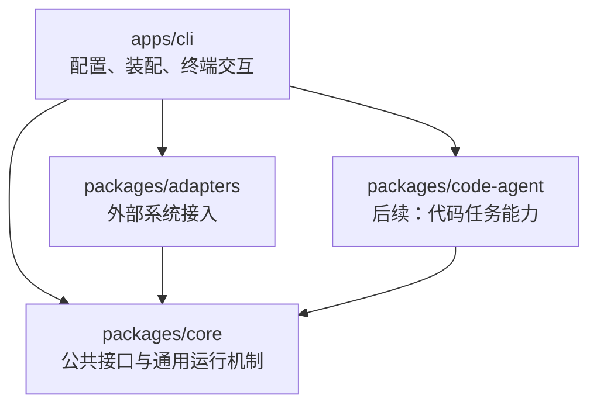
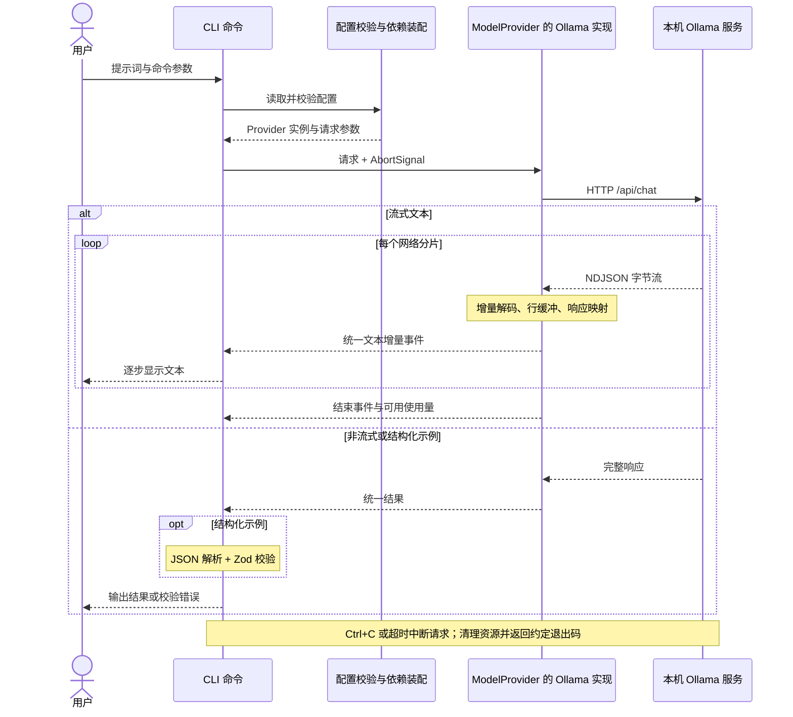
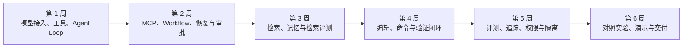

# ts-code-agent 架构设计

状态：Day 1–3 已实现；Day 2 验证和限制见 docs/learning/day-02.md；Day 3 记录见 docs/learning/day-03.md。本文同时描述后续演进；验证结果见 README。

## 1. 设计原则

采用 CLI 优先、少量 workspace 包、包内按能力分模块的结构。将通用 Agent 机制、外部协议接入和代码领域能力分离，以适配 6 周学习与交付节奏。

通过构造参数显式注入依赖，暂不引入 DI 容器。只有出现实际使用场景时才增加模块或扩展抽象。

## 2. 技术栈

| 层面           | 选择                                                     |
| -------------- | -------------------------------------------------------- |
| 语言与运行时   | TypeScript strict、机器默认 Node.js、ESM                 |
| 包与版本       | pnpm workspace、lockfile；记录 Node 版本，固定 pnpm 版本 |
| 开发与构建     | tsx、tsc；采用与 Node ESM 一致的模块解析设置             |
| 配置和输入校验 | Zod                                                      |
| CLI            | Commander                                                |
| 模型接入       | 原生 fetch、Ollama 原生 API                              |
| 测试           | Vitest，默认离线                                         |
| 代码检查       | ESLint、Prettier                                         |
| 后续日志       | Pino；与可订阅运行事件分开                               |
| 第 2 周协议    | MCP 官方 TypeScript SDK                                  |
| 第 2 周持久化  | 文件 Checkpoint 适配器                                   |
| 第 3 周检索    | PostgreSQL + pgvector、独立 Embedding 接口               |

依赖版本在初始化时根据实际兼容性固定；本文不预设未经验证的版本组合。Ollama 原生运行在 macOS，数据库可在后续使用容器。

## 3. 包边界与依赖

下图展示目标包依赖；实线箭头表示源码依赖方向，不表示运行时数据流。Code Agent 在 Day 2–6 按需创建，Day 1 创建 CLI、Core 与 Adapters；其余能力按学习进度实现。



- Core 定义模型、工具、存储等接口及通用运行逻辑，不导入具体接入包。
- Adapters 将外部系统映射为 Core 接口。
- Code Agent 提供代码任务规划、仓库探索、编辑和验证，通过接口使用检索等依赖。
- CLI 是装配入口，负责配置、命令、终端输出和审批交互。
- 不创建通用 `utils` 或 `shared` 大杂烩；辅助函数放在所属模块内。
- 不用 TypeScript paths 掩盖包依赖；workspace 包通过明确的公开入口和正确的构建配置连接。

## 4. Day 1 实际目录

```text
ts-code-agent/
├── AGENTS.md
├── apps/cli/
│   ├── src/
│   │   ├── main.ts
│   │   ├── bootstrap.ts
│   │   ├── config.ts
│   │   └── commands/
│   │       ├── chat.ts
│   │       └── structured-demo.ts
│   ├── package.json
│   └── tsconfig.json
├── packages/core/
│   ├── src/
│   │   ├── index.ts
│   │   └── model/
│   │       ├── provider.ts
│   │       ├── messages.ts
│   │       ├── events.ts
│   │       └── errors.ts
│   ├── package.json
│   └── tsconfig.json
├── packages/adapters/
│   ├── src/
│   │   ├── index.ts
│   │   └── ollama/
│   │       ├── provider.ts
│   │       ├── mapper.ts
│   │       ├── stream-parser.ts
│   │       └── stream-parser.test.ts
│   ├── package.json
│   └── tsconfig.json
├── tests/
│   ├── integration/
│   └── fixtures/
├── docs/
│   ├── spec.md
│   ├── architecture.md
│   └── adr/                     # 有实际决策记录时创建
├── .env.example
├── .gitignore
├── package.json
├── pnpm-workspace.yaml
├── pnpm-lock.yaml
├── tsconfig.base.json
├── vitest.config.ts
└── README.md
```

测试按实际行为补充，目录不要求全部预先创建。第一天不创建 Code Agent、Web、API 或 contracts 包。

## 5. 模型接入设计

`ModelProvider` 提供普通生成和流式生成两种入口，使用统一的请求、消息、结果和事件类型。请求接受 AbortSignal、模型参数与可选结构化输出 Schema。

- Core 仅包含当前使用的公共概念；工具字段在 Day 2 需求落地时加入。
- Provider 声明实际支持能力；不承诺所有模型均支持结构化输出或工具调用。
- Ollama 的原始字段、NDJSON、使用量与错误在适配层转换。
- Day 1 流式事件包含文本增量和结束事件；失败抛出统一可区分错误，取消单独处理。
- 流解析使用增量 UTF-8 解码与行缓冲，处理跨分片字符、多行、尾行及服务端错误，不假设网络分片对应 JSON 行。
- 调用方累积结构化文本并做 JSON 解析、Zod 校验。JSON Schema 是生成约束，Zod 是程序边界验证。
- 超时与用户取消组合传递到 fetch；结束或异常时清理读流与监听。
- 使用量可能缺失，表示为可选值；token 估算不能伪装成准确统计。

Day 1 保持非交互式单次命令简单。后续多轮聊天复用同一 Provider 接口。

### Day 1 调用与返回流程

下图展示设计中的运行时调用。`ModelProvider` 是 Core 定义的接口，具体实例由 CLI 装配为 `OllamaProvider`；图中的接口调用不增加 Core 对 Adapters 的源码依赖。



网络、HTTP 和协议错误由适配层分类，CLI 将错误写入 stderr。取消与超时适用于上图所有请求阶段；上图只展开正常响应分支。

## 6. 后续模块演进

| 时间            | 新增模块                                                                         |
| --------------- | -------------------------------------------------------------------------------- |
| 第 1 周 Day 2–6 | Core/tools、agent、context；创建 Code Agent 包并加入只读工具                     |
| 第 2 周         | Core/workflow、Checkpoint 接口；Adapters/mcp、storage；examples/mcp-server       |
| 第 3 周         | Code Agent/retrieval；Adapters 中 Embedding 与 PostgreSQL 实现；infra/migrations |
| 第 4 周         | Code Agent/planning、repository、editing、verification、permissions、prompts     |
| 第 5 周         | evals/cases、runner、scorers；运行追踪与资源控制                                 |
| 第 6 周         | experiments/langgraph、multi-agent；演示、部署与周复盘                           |

运行事件由 Core 定义，CLI 订阅并显示。后续扩展 `run.started`、`tool.started`、`approval.required` 等事件。日志供诊断，事件用于业务状态与评测，两者不能相互替代。

Checkpoint 保存版本化、可序列化状态；不保存工具函数、网络连接或 AbortController。恢复时重新装配依赖，并明确尚未完成的副作用处理策略。

未来 API 管理任务生命周期，Web 订阅对外事件，新增 contracts 通信 Schema。当前仅保留这一方向，不实现后台任务服务或网络协议。

### 六周能力演进

下图表示交付顺序，不表示模块之间的代码依赖。每阶段在前一阶段可运行成果上扩展；框架和多 Agent 实验保留在独立实验目录。



## 7. 验证策略

- 流解析、映射、配置和结构化校验进行离线测试。
- Fake Provider 用于后续 Runtime 的确定性测试。
- CLI 集成检查输出、退出码、取消和错误；使用模拟服务，不依赖模型随机输出。
- 真实 Ollama 冒烟检查独立执行，记录环境与结果。
- 每阶段以 `docs/spec.md` 和当天 Issue 的验收标准判断完成，不以目录数量或代码行数判断。

## 8. 参考资料

- Ollama Chat API：https://docs.ollama.com/api/chat
- Ollama 配置：https://docs.ollama.com/faq
- TypeScript Project References：https://www.typescriptlang.org/docs/handbook/project-references.html
- Vitest：https://vitest.dev/guide/
- MCP TypeScript SDK：https://github.com/modelcontextprotocol/typescript-sdk
- pgvector：https://github.com/pgvector/pgvector

## 9. Day 2 实际实现

Core/tools 提供通用工具描述、运行时校验接口、结果联合类型、注册表及执行器。注册时通过泛型包装闭包保留 Schema 与 execute 的输入类型关系，对外统一为接收 unknown 的 invoke。Core 不依赖 Zod；CLI 的 add 工具使用 Zod 实现校验并转换 JSON Schema。

ModelMessage 按角色区分普通消息、带 toolCalls 的 assistant 消息及带工具名的 tool 结果。Adapters/ollama 负责 Core 与 Ollama 字段转换及响应边界校验；不执行工具。

CLI tools-demo 装配 Provider、注册表和执行器，按“首次生成、顺序执行工具、回传全部结果、再次生成”运行。流式工具事件尚未设计，因此 stream 显式拒绝工具请求及意外工具响应。Agent Loop 留待 Day 3。

ToolExecutor 以停止 Promise 与工具 Promise 竞争，向工具转发组合后的取消信号并清理资源。取消为协作式，不提供进程隔离、强制终止或事务回滚。

## 10. Day 3 实际实现

Core 的 agent/runner.ts 定义 AgentRunOptions、AgentResult、EAgentStatus 和 AgentRunner，通过公开入口导出。构造时注入 ModelProvider 和 ToolExecutor，run 接收请求及 maxSteps。Core 运行代码不依赖 Zod；Core 的 devDependency Zod 仅用于工具测试。

每次 run 复制消息数组，并将同一 AbortSignal 传给模型与工具；没有外部信号时创建内部信号。每轮模型响应先写入一条完整 assistant 消息，再判断是否含工具调用；工具结果按顺序以 JSON 字符串写入 tool 消息。普通工具失败继续回传，取消及 Provider 错误向上抛出。

模型请求次数达到上限时，最后一轮工具仍执行，返回 max_steps；无工具调用则返回 complete。返回值包含 steps 和 messages，完成时还包含 ModelResult。Runner 不保留跨 run 的内部对话状态；继续对话需要调用方显式传回历史，新 run 重新计步。

CLI agent-demo 负责计算任务的系统提示、工具注册、固定 10 步上限及终端输出。提示遵循与任务正确性不由通用循环保证；不引入自动恢复或结果验证模块。

### Day 3 并行调度补充

AgentRunOptions.toolExecution 使用 EToolExecution 枚举，可选 SEQUENTIAL（默认）或 PARALLEL。并行分支使用 Promise.all 启动同轮工具，保留原调用顺序并在结果全部就绪后追加 tool 消息。ToolExecutor 将普通工具失败转换成 ToolResult，因此一个失败不会使同轮其他结果丢失。两种模式在执行前检查取消，并将同一任务信号传给执行器；并行工具已经开始后，取消无法使它们从未执行。仅对相互独立的调用启用并行，当前不增加调度队列或并发上限。
