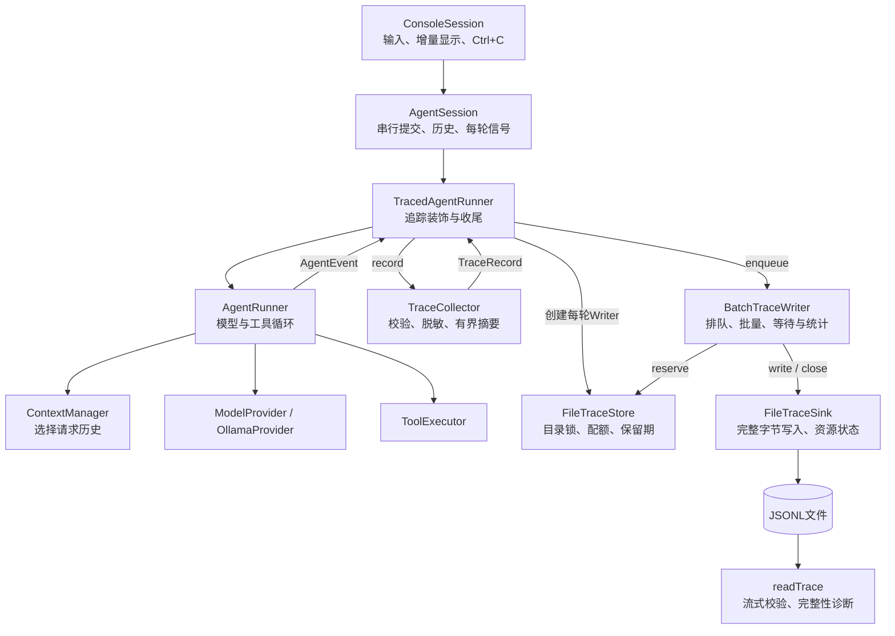

# Session、流式 Agent 与 Trace 学习回顾

整理日期：2026-11-12。覆盖本轮 #45/#46 可靠性复盘、#26 生命周期事件与Trace实现，以及上下文预算讨论。依据当前源码、session-cli.md、trace-collector.md及本轮对话整理。日期跨度不等于实际投入工时；没有完整计时记录，不推算学习总小时。

## 一、这次到底在解决什么

本轮不是从零写一个Agent，而是把已有Agent逐步补成能多轮使用、能解释执行经过、能在异常后继续使用的本地Runtime。

主线有三个连续问题：

1. 运行正确：一次输入会发生多次模型请求和工具执行，如何维护历史、取消、步数和流式协议？
2. 过程可解释：运行停在哪一步，工具何时开始/结束，谁先完成，为什么结束？
3. 证据可保存：如何把事件留下，同时控制内存、磁盘和失败影响？

上下文预算贯穿第一条主线；Trace使预算、模型耗时、工具耗时等问题具备进一步观测基础，但当前没有自动调参或精确tokenizer。

## 二、先把三个生命周期分开

```text
CLI session（多轮会话）
  ├─ run 1：用户输入一次
  │    ├─ step 1：模型响应 → 工具执行
  │    └─ step 2：模型响应 → 最终回复
  ├─ run 2：用户再次输入，maxSteps重新计数
  │    └─ ...
  └─ 退出：停止会话，收尾TraceStore
```

Session拥有已确认历史和每轮AbortController；Runner执行一个run；step是一次模型请求，不是一次工具调用。一个模型响应可以要求执行多个工具。

complete代表模型不再请求工具，max_steps代表达到模型请求步数限制；两者都不自动证明用户任务正确完成。

## 三、整体架构



图中是调用关系，不是代码包依赖。Core包含Runner、ContextManager、ToolExecutor、Collector及通用接口；Adapters实现模型和文件系统接入；CLI负责装配。Core不依赖Adapters或CLI，Collector不会直接创建文件。

不开启--trace时，Session直接使用Runner；开启后经过TracedAgentRunner装饰。执行业务逻辑只有一套，不为追踪再复制一套Agent Loop。

## 四、一次正常请求如何走完

1. ConsoleSession读取输入，调用AgentSession.submit。Session拒绝忙碌或已关闭状态下的新任务。
2. Session创建全新的AbortController，复制已确认历史并加入当前用户输入，状态变为RUNNING。
3. 追踪装饰器分配runId，Store创建文件、写header并交付Writer；创建失败则提示并继续Agent。
4. Runner发RUN_STARTED。每一步先用ContextManager选择请求消息，再发MODEL_STARTED并调用Provider。
5. 流式TEXT_DELTA用于即时显示。Provider确认完整响应，Runner消费完合法事件流后才发MODEL_FINISHED，追加一次完整assistant消息。
6. 有工具调用时，为每项分配toolCallId并发READY，交执行器前发STARTED，取得并编码结果后发FINISHED；普通工具失败同样生成tool消息。消息按原调用顺序保存。
7. 没有工具时正常结束；达到maxSteps也正常返回对应结果。Runner发RUN_FINISHED。
8. 追踪装饰器finally关闭Writer。Session得到结果后再次检查取消，正常返回才提交整轮历史；异常不提交本轮。
9. finally清理控制器，非CLOSED会话恢复IDLE，允许下一轮。

追踪收尾可能增加本轮返回等待时间，但失败不会把成功Agent结果改成失败。若收尾期间用户取消，Session的最后信号检查仍可能阻止本轮历史提交。

## 五、历史、流式与取消：为什么这样设计

| 决策                           | 解决的问题                                          | 代价或边界                             |
| ------------------------------ | --------------------------------------------------- | -------------------------------------- |
| 正常返回才提交完整一轮         | 避免失败后留下半条assistant、缺少配对结果的工具历史 | 本轮已显示文字和外部工具副作用不会回滚 |
| 每轮新AbortController          | aborted状态不可恢复，不能复用已取消信号             | 需要明确控制器属于哪一轮               |
| 取消只发信号，收尾后才恢复IDLE | 防止旧任务尚未停止，新任务已执行                    | 忽略取消信号的底层操作可能继续运行     |
| 文本增量仅用于显示             | 首段可提前输出，最终历史不会重复保存碎片            | 已显示但失败的文本必须标记不完整       |
| 完整响应确认后才执行工具       | 避免参数碎片尚未完整就触发副作用                    | 不能把“看起来像完整JSON”当作协议完成   |
| 流式/非流式共用Runner主流程    | 交互不同，历史、状态、结果规则保持一致              | 两种模式仍需独立预期断言，防止共同犯错 |

MODEL_FINISHED是一次模型响应结束，RUN_FINISHED是整个Agent run结束。工具仍可能在两者之间执行，不能把模型结束当作任务结束。

## 六、工具与事件：三种顺序不应混用

工具调用A、B同时开始，B先完成：

```text
模型调用顺序：A、B
实际完成事件：B FINISHED、A FINISHED
回传模型消息：tool A、tool B
```

事件描述实际发生时间，模型历史保持调用与结果的对应关系。因此依靠runId、step和toolCallId关联，不用工具名或完成顺序猜关联。

工具普通失败、参数校验失败、工具超时都可能作为失败结果返回模型，在仍有步骤时由模型继续处理；Provider失败、取消和未处理异常属于不同的run终止路径。并行执行用allSettled等待已启动的执行包装完成后再处理终态，但不代表强制终止了忽略信号的底层副作用。

BigInt问题让我们认识到“工具函数成功”与“能交付给模型”之间还有编码边界。当前BigInt转十进制字符串，保留数值精度但改变字段类型；循环引用等其他不可序列化结果仍可能失败。仅让ModelMessage.content支持对象并不能消除最终协议的序列化需求。

迟到、缺失和重复事件应保留诊断意义，不能据此伪造确定状态。当前Collector可处理收到的迟到事件；它不能观察底层从未通过AgentEvent发出的信息。

## 七、Trace模块为什么这样拆

| 模块             | 核心问题                                     | 刻意不承担的职责               |
| ---------------- | -------------------------------------------- | ------------------------------ |
| TraceCollector   | 这条事件允许保存哪些字段，当前摘要是什么？   | 文件路径、磁盘IO、写入调度     |
| BatchTraceWriter | 何时批量写，谁在等写完，拒绝了多少？         | 目录锁、底层短写、模型执行     |
| FileTraceSink    | 这一批字节是否完整写入，句柄是否关闭？       | JSON事件含义、footer生成、排队 |
| FileTraceStore   | 谁拥有目录，活动文件占多少，哪些旧文件可删？ | 模型历史与事件状态推断         |
| readTrace        | 文件有哪些可信记录，有哪些完整性缺口？       | 自动修复文件、恢复Agent执行    |
| CLI装饰器        | 如何连接各模块，如何提示失败并收尾？         | 重写Agent Loop或文件IO算法     |

Collector返回脱敏记录交给Writer，同时维护有界摘要，不在内存复制全部时间线。getSnapshot返回独立副本，避免调用者修改过去的快照或内部状态。按允许字段构造记录比直接克隆原始事件更能限制敏感内容传播。

READY后未STARTED表示未执行；STARTED后无FINISHED表示结果缺失。即使run取消，也不能直接把所有工具标成cancelled。重复结束保留第一次有效结果；缺开始的结束可保留事实，但不能捏造耗时。

## 八、BatchTraceWriter为什么看上去最复杂

它同时连接同步生产者和异步消费者：Agent快速发事件，磁盘可能慢、失败或一直不返回。复杂度来自容量、顺序、等待和收尾的组合，而不只是“数组凑够一批”。

先记住四条路径：

```text
接收：enqueue → schedule / kick
写出：kick → drain → sink.write → 更新written → releaseBarriers
等待：flush → barrier → 等待指定accepted目标
关闭：close → finish → 等barrier和drain → footer → sink.close → settled
```

- enqueue同步返回接收结果，不等待磁盘。选择满队列拒绝，避免追踪拖住主Agent；代价是有明确统计的事件缺口。
- pendingBytes包含队列与在途批次。取出队列不代表写完，只有写入完成才释放普通内存容量。
- 单个drain串行写出，运行期间新事件由同一个循环继续处理。阈值和定时器负责启动，不能将每一批都理解成至少等100ms。
- barriers存的是等待请求，不是事件。只有flush或finish需要等待未完成记录时才登记；每批写完后才有条件通知等待者。
- flush固定调用当时的目标，之后的新事件不延长这次等待。若把“队列为空”作为唯一条件，持续输入可能使等待饥饿。
- close停止接收并缓存同一个Promise。外层超时返回TIMED_OUT，后台收尾继续，settled表示最终结果。

本轮实际修复了两个问题：flush超时后未删除内部等待项；reserve异常时，失败barrier提前解除，导致在途写入尚未结束就关闭文件。前者给每个flush等待项独立超时清理，后者单独等待drainPromise。它们说明“通知等待者”和“IO真实完成”是两个不同条件。

Promise<void>仍然是一个可等待成功或失败的对象。closeHandle是async，虽然无业务返回值，仍返回Promise；外层close不加async，是为了直接返回缓存对象，而不是再包装一个Promise。

## 九、文件、目录和恢复：为什么不能只appendFile

单次write可能只写入一部分字节，writeFully必须推进输入偏移直到全部完成；零进展报错避免死循环。部分写入后失败意味着文件已有前缀，不能假设磁盘占用为零，也不能无条件重试整批。

wx排他创建把“文件不存在才能创建”的判断交给文件系统，避免先exists再open的时间间隙。开始关闭后不再允许写；关闭失败不等于文件仍安全可写。

每个run文件不同，但同目录的Store需要竞争同一个.writer.lock，因为配额和旧文件清理是目录级共享决策。锁被外部替换时，旧Store不得删除新文件；用设备号和inode核对身份。该机制面向遵守协议的本地进程，不是同用户恶意篡改的安全边界。

配额必须先预留再写，包含活动、排队、在途和控制空间。close等待超时的文件仍是活动文件；真实收尾完成后才可解除保护。首次RUN_FINISHED和footer保留空间，降低普通事件填满容量后无法留下终态和统计的风险。

header提供版本、runId与UTC创建时间；footer提供accepted/written/dropped等统计。RUN_FINISHED说明Agent结束，footer说明追踪写到了统计收尾步骤，二者不能互相替代。footer写在close之前，不能证明关闭成功或fsync持久性。

JSONL适合追加、流式读取和保留崩溃前缀；代价是要显式处理半行、损坏、缺口与版本。Reader输出诊断而不伪造成功，也不自动恢复任务。

## 十、上下文预算与Trace的联系

需要区分四个概念：模型能力上限、服务实际配置、本次请求窗口、应用为输入保留的预算。

```text
可用消息预算 = contextLength - 输出预留 - 工具定义估算
消息预算容纳 = system + 当前完整轮次 + 能放下的最近历史轮次
```

当前session输出预留1024，本地估算使用序列化UTF-8字节数加固定开销，不是真实tokenizer，输出预留也未作为生成长度上限传给Provider。当前完整轮次含其工具调用结果，不只是用户一句问题；必要轮次放不下就报错，不静默丢掉当前工具结果。

会话完整历史保留在内存，ContextManager只裁剪本次发给模型的历史；reset清理历史但不扩大模型窗口。当前内存完整历史并无长期会话总量上限，因此Trace有界不代表整个Agent进程内存都有界。

之前真实Trace冒烟显式使用8192；当前工作区config.ts默认值已变为40960（本次总结未修改）。模型元数据上限不代表机器最合适配置，旧8192验证不能自动证明新窗口的资源与性能。需要结合真实输入token、工具输出大小、裁剪和延迟评估；当前Trace尚未新增上下文裁剪事件，不能声称这些数据都已自动采集。

## 十一、怎么证明实现可靠

测试分层而不是只看总数量：

- 纯逻辑测试：Collector、预算、事件关联、序列化，证明状态规则。
- 可控异步测试：gate/deferred/虚拟计时器控制先后，证明取消、在途容量、超时和关闭。
- 临时文件测试：证明权限、不覆盖、部分写入、锁竞争、配额与恢复读取。
- CLI子进程加Fake HTTP：证明真实终端提前显示、多轮、错误、SIGINT/EOF和Trace装配。
- SIGKILL与压测：证明崩溃前缀诊断及慢消费者下有界拒绝。
- 真实Ollama：证明所测配置下实际交互链路；模型回答正确性与Runtime正确性分别记录。

2026-11-17收尾验证：34文件/357项通过，typecheck/lint/build通过；format:check仅既有.vscode/settings.json失败。当前覆盖与未验证边界见[Trace收尾记录](trace-collector.md#本轮收尾2026-11-17)；真实模型与压测仍采用下述历史证据，本轮未重跑。

真实模型两组证据不能混淆：11月5日三轮仓库问答记录6次模型请求/4次read_file，同时保留模型解释错误；11月11日Trace冒烟包含工具、追问、取消与恢复，共4个footer并释放锁。细节见session-cli.md及trace-collector.md。

## 十二、这次学习方式的复盘

前半段逐问逐答有助于确认边界，但进入BatchWriter时，过早从barriers等局部开始，导致缺少全局调用模型。后来按整体职责、主流程、状态、异常、代码、测试推进，理解明显更连贯。

以后每进入新模块，固定顺序：它解决什么问题 → 输入输出与生命周期 → 与其他模块的关系 → 正常流程 → 异常流程与资源归属 → 代码与确定性测试。先把“谁调用谁、谁负责释放”讲清楚，再讨论某一行Promise或偏移量。

可用以下问题做闭卷复述：

1. Session、run、model step分别何时开始和结束？
2. 为什么正常返回才提交历史？max_steps为什么可提交？
3. 什么证据允许执行工具，什么证据允许宣布run结束？
4. 并行工具的事件顺序和模型消息顺序为什么不同？
5. Collector摘要完整与磁盘文件完整为什么不是一回事？
6. flush超时为什么只删除等待请求，而不删除事件？
7. Writer.close超时后，Store为什么不能释放锁或回收文件？
8. Sink关闭成功为什么不能把Writer写入失败改成成功？
9. footer为什么不是持久化证明？
10. 窗口放不下当前完整轮次时，为什么不能只裁掉一条tool消息？

推荐阅读顺序：agent-session.ts → runner.ts → collector.ts → batch-writer.ts → file-trace-sink.ts → file-store.ts → session-trace.ts → reader.ts。沿一个完整run阅读，再沿一次取消或磁盘失败阅读，比按文件行号从头到尾更容易建立联系。
