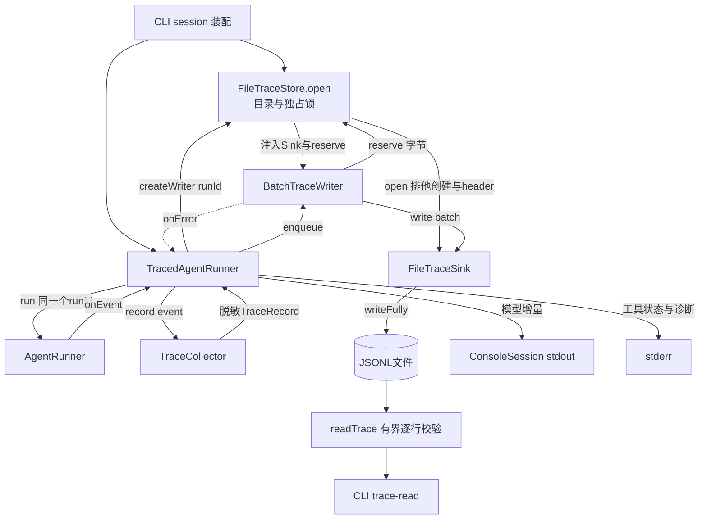
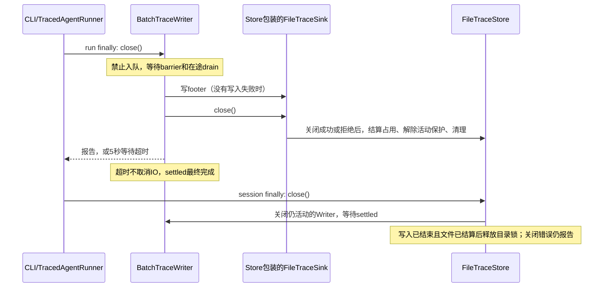

# Trace：实现、调用关系与验证

更新：2026-11-17。关联 #26；在现有 session 流式/非流式 Agent Loop 上添加诊断追踪，不改变工具失败回传模型与历史提交规则。

## 使用

```sh
pnpm dev session --trace --workspace .
pnpm dev session --trace --no-stream --workspace .
pnpm dev trace-read .agent/traces/<实际文件名>.jsonl
pnpm exec tsx scripts/trace-benchmark.ts
```

默认不开启追踪。文件位于工作区的 `.agent/traces`；新目录0700、文件0600。模型文本仍到stdout；工具状态、保存路径、丢弃数和追踪错误到stderr。`trace-read` 仅输出校验后的允许字段，诊断输出到stderr，有完整性诊断时退出码为1。

追踪创建失败、写入失败或容量不足只影响追踪，Agent继续运行；CLI提示一次。每次run一个文件、一组Collector/Writer；整个session共享Store与目录锁。

## 模块调用图



Core不调用Adapters；Collector不持有Writer。CLI装饰器先初始化追踪，再调用Runner，Runner事件经同一个回调分发给Collector和终端。Runner支持传入安全runId，默认仍自动生成。

## 关闭调用图



`flush`只等待调用时的已接收进度，不关闭文件；自己的超时会移除自己的barrier。`finish`使用不带超时的内部barrier。`close`缓存Promise，`settled`代表真正收尾；等待超时不代表文件已关闭，也不保证进程立即退出。

## 保证边界

- Collector按接收顺序生成sequence，显式挑选元数据；不保存提示词、文本正文、工具参数/输出、异常message/stack、finishReason。摘要复制返回并限制模型/工具/异常样例数量。
- Writer默认64 KiB批次、100ms触发、普通排队加在途1 MiB、单条64 KiB；首次终止事件和footer各保留4 KiB。合并批次还会产生一个固定额外缓冲，字节预算不是整个进程RSS上限。
- Store默认保留7天、目录预算256 MiB；启动、创建新run、实际文件关闭时清理本项目命名的已关闭文件，优先旧文件。未知内容计入预算但不删除；活动文件受保护。
- 配额在同步入队前预留，覆盖排队、在途和8 KiB控制空间。容量不足拒绝普通事件并计入丢弃，仍可写预留的终态/footer。清理不是每个事件都触发；本轮达到预算后可能丢弃，下一次生命周期清理才回收旧文件。
- 目录扫描使用流式目录迭代，最多10000项、深度64；超过时停止并报告不可用，不继续无界扫描。
- Sink处理部分写入；失败后禁止再写，仍尝试关闭。已写入的前缀不回滚，不能安全重试整批。
- footer记录写入统计，在文件关闭之前写出；它不是关闭成功或fsync证明。文件存在完整footer也可能随后发生关闭失败，进程内报告会明确失败。
- 独占锁用于遵守协议的本地进程。只对格式合法且PID明确不存在的锁进行恢复；活PID、权限不足、未知锁、PID复用均拒绝接管。恢复门锁异常遗留时保守拒绝，需要人工确认；不承诺防御同用户恶意路径替换。
- 关闭操作仍pending时保留活动保护；关闭已拒绝且所有写入结束后，Store结算实际文件大小并解除活动保护，允许后续追踪及最终释放锁。文件大小无法确认时仍保留预留与目录保护；关闭错误继续由Writer报告，不代表句柄已释放。当前实现无后台重试服务、远程上传、fsync或崩溃后任务续跑。
- Reader限制单行64 KiB，校验unknown、版本、UTF-8与字段，报告缺头/缺尾、序号缺口、错误顺序、runId不符、非法行、超长行、尾部截断和缺失run终态；合法记录可继续读取。读取结果不用于恢复Agent执行。

## 验证证据

离线覆盖：Collector摘要/脱敏/乱序与迟到，Writer满队列/终态槽/超时/并发flush/在途关闭，Sink短写/异常/文件权限，Store锁竞争/PID恢复/配额/活动保护/关闭失败，Reader损坏与取消；CLI子进程覆盖流式与非流式多轮、工具成功失败、模型HTTP错误、SIGINT取消后继续、EOF/exit、追踪初始化失败和默认关闭。

强制退出：子进程flush后SIGKILL，Reader恢复已写前缀并报告缺少footer和终态；这不代表fsync持久性。

2026-11-11真实Ollama冒烟：服务0.40.3，qwen3:8b，think=false，context-length=8192，请求超时60000ms，临时只读工作区。第一轮调用list_directory，第二轮引用历史，第三轮在模型开始后取消，第四轮正常回复OK。共4个trace、4个footer、3个complete与1个cancelled，工具开始1次，均无丢弃，退出码0且锁释放。第一轮13.282s，第二轮1.500s，整体15.489s。临时产物已清理。模型把.agent目录也列入答案，工具行为正确不等于回答质量验收。

10万TEXT_DELTA事件压测（Node v26.12.1，本机单次观测）：正常文件写入100000条、丢弃0、200次write、约188ms、观测普通待写高水位208000字节；人为每次write延迟10ms时写入19741条、丢弃80259、33次write、约381ms、flush约180ms、高水位1048561字节（小于1048576）。该压测输入不包含完整Agent生命周期，验证队列吞吐与拒绝策略；完整生命周期由CLI与集成测试验证。数据受调度与机器负载影响，不是性能SLA。tsx在Node26下会输出依赖的module.register弃用警告。

2026-11-12实际执行：`pnpm typecheck`、`pnpm test`（34文件/354项）、`pnpm lint`、`pnpm build`均通过。`pnpm format:check`唯一失败为既有 `.vscode/settings.json` 格式问题，本次未修改该文件；其余文件通过。`git diff --check`通过。没有自动提交或推送。既有学习计划中的真实投入小时与截止容量尚无完整工时记录，不能根据测试通过推断排期全部达成。

从Session、流式协议到Trace的整轮学习复盘，见[Session与Trace学习回顾](session-trace-retrospective.md)，包含生命周期、模块取舍、异常路径和复习顺序。

## 本轮收尾（2026-11-17）

当前离线基线为34个测试文件、357项测试。Node v26.12.1、pnpm 10.34.7；typecheck、test（包含build）、lint通过。Trace相关文件格式已整理；全仓库format:check仍受既有`.vscode/settings.json`格式问题影响，该文件未修改。本轮未重新执行真实Ollama冒烟或性能压测，上面的历史证据保留原日期和参数。

| 风险                       | 当前覆盖                                                                          |
| -------------------------- | --------------------------------------------------------------------------------- |
| 普通事件配额不足           | 拒绝计数，终态与footer使用预留空间                                                |
| 配额不足与文件关闭失败组合 | 已接收记录落盘、关闭失败报告、下一轮创建时删除旧文件、第二轮实际写入、新Store接管 |
| 关闭等待超时               | Writer等待超时但后台继续；Store在真实关闭完成前保留目录锁                         |
| 异步写入与关闭交错         | 在途容量计数、等待drain结束再关闭、flush独立等待目标                              |
| 崩溃与文件损坏             | SIGKILL后读取合法前缀，报告缺尾、缺终态及损坏记录                                 |
| 追踪故障影响Agent          | 初始化或写入失败不改变Agent结果，CLI输出诊断                                      |

结论限于本地诊断追踪的当前实现，不代表断电持久性或远程生产部署验收。关闭失败仍可能留下未释放句柄；逻辑文件字节配额不等于文件系统物理块或进程内存上限。关闭永久pending时继续保留保护，当前没有后台重试或强制终止IO机制。预算充足时pending关闭不阻塞新Writer创建的组合场景尚无专门回归用例，不能将已有超时锁测试视为该场景的直接证据。

本轮不调整用户的context-length配置，不自动提交、推送或关闭GitHub Issue；阶段A的后续计划集成与总工时校准仍是独立任务。
