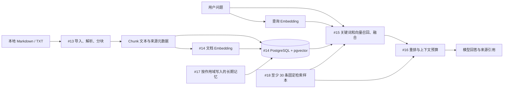
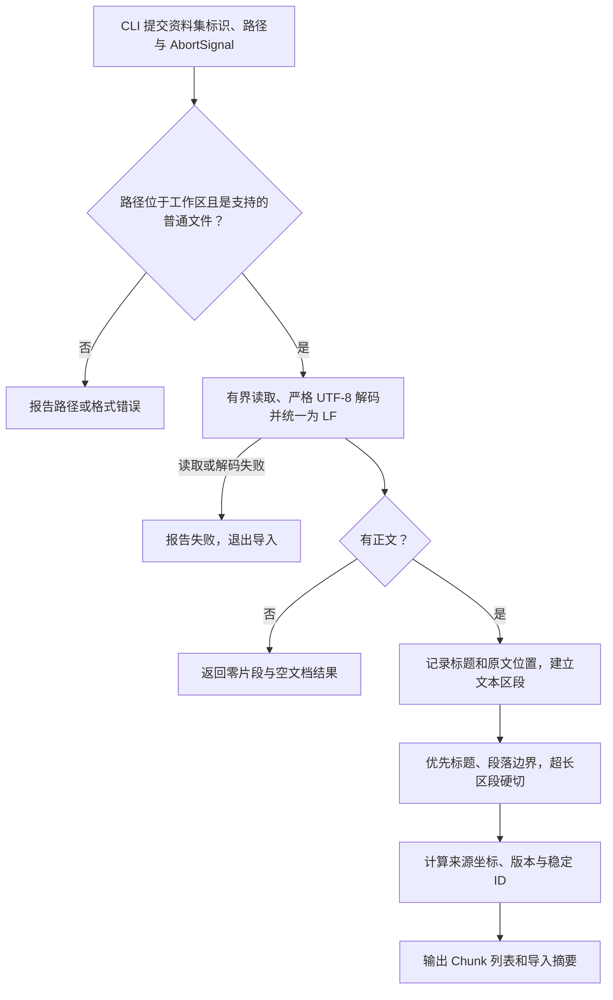

# 阶段 D · RAG 架构与文档导入设计

当前实现已按人工确认的 Core 通用能力边界重构，初始设计中的模块职责以下述最新分层为准。当前聚焦 [Issue #13](https://github.com/BernardZhang/ts-code-agent/issues/13) 的文档导入、文本分块、元数据提取及主项目可运行示例。路线将 #24 列为正式交接依赖，为 #13 安排 11 月 26–27 日共 8 小时。本次提前准备分支与设计，排期以[学习路线](../../learning-roadmap.md)为准。

## 阶段 D 架构

RAG 有两条路径。建索引时把原始资料变成可定位的片段，查询时先找证据，再把预算内的候选交给模型生成带引用的回答。同一份 Markdown/TXT 语料贯穿导入、检索与评测。

- `apps/cli` 装配输入范围、命令、取消和结果展示。#13 使用独立的导入演示入口，方便检查分块结果。
- `packages/core/src/retrieval` 定义 Document/Chunk、读取与存储契约，实现通用解析、分片、批量向量化和入库编排。
- `packages/code-agent/src/retrieval` 负责工作区路径校验，调用注入的读取函数并使用 Core 完成文档创建、解析与分片。应用内导入通过包公开入口。
- `packages/adapters/src/documents` 负责普通文本文件的有界读取和严格 UTF-8 解码，Core 导入层统一处理文本规范化；CLI 将其注入工作区导入。
- `packages/adapters` 在 #14 接入一种 Embedding 模型和 PostgreSQL/pgvector。需要跨包共享时，在 #14 定义最小的通用接口并遵守依赖方向。选用具体模型、维度和索引参数前，用共享语料验证。
- `packages/core` 继续提供通用 Runtime 与上下文预算。#16 在调用层组装有界证据，把资料作为外部数据交给模型，并校验输出引用是否属于本次实际送入的证据。#17 先用显式作用域约束召回，再做排序，避免跨作用域取回记忆。

## #13 导入逻辑

初版设计选择由操作者显式传入一个工作区相对路径。CLI 显式提供稳定的 `corpusId`，供导入模块生成文档 ID。对每个文件先获得可验证的纯数据结果，后续再由 #14 接管持久化。文档正文只在演示中按需预览，正常输出使用路径、范围和片段数。

- **读取**。复用现有工作区路径校验逻辑，检查真实路径，防止越界。以字节数约束读取，拒绝非法 UTF-8 和含 NUL 的正文，可接受 UTF-8 BOM。读取及分块循环定期检查 `AbortSignal`，取消与读取错误分别报告，失败或取消时不交付部分片段。路径检查给出应用层约束，无法提供文件系统快照。
- **解析**。规范化仅移除开头的 BOM 并转换换行符。Markdown 识别 ATX 标题和围栏代码块内外的边界，提取标题层级，保留原始标记和代码文本。围栏里的 `#` 属于代码。TXT 优先以空行识别段落。空文件和纯空白文件返回零片段。
- **分块**。先按结构分段，再在单段内尽量沿换行或空白切割，最后按 Unicode 码点硬切以确保前进。初版以 **800 码点、零重叠**为实验默认值。无空白长行同样受限。任意后续重叠需保持来源坐标准确，并用评测验证召回收益。

### 建索引交接字段

| 字段                       | 含义                                                                          |
| -------------------------- | ----------------------------------------------------------------------------- |
| `sourcePath`               | 工作区相对路径，使用 `/` 作为分隔符                                           |
| `documentId`               | 由资料集标识与相对路径确定的逻辑文档 ID，同一路径的内容更新沿用此 ID          |
| `contentHash`              | 规范化全文哈希，用于判断文档版本                                              |
| `chunkId`                  | 基于文档 ID、内容版本、分块规则版本及片段范围计算，同输入和同规则重跑结果一致 |
| `text`, `ordinal`          | 原文连续切片，序号在同一文档版本内从 0 开始                                   |
| `startOffset`, `endOffset` | 规范化全文的 UTF-16 半开区间，`text` 可由 `slice` 复现                        |
| `startLine`, `endLine`     | 1 起始、两端包含，末行由最后一个字符的位置确定，支持同一行内的多个片段        |
| `headingPath`              | Markdown 标题层级数组，TXT 或首标题前为空                                     |

#14 批量向量化成功后，再事务性替换该逻辑文档的片段集合。内容、分块规则或 Embedding 模型版本变化都触发重建。只要旧版本完整，新的一批中途失败仍可继续查询旧版本。#16 使用本轮证据的 `chunkId` 映射回资料集、路径、版本和行号。

## 学习与验收

先手推一个 Markdown 文件，依次标记两级标题、围栏内的 `#` 和一个超长段落。试着从每个 Chunk 的范围反算原文，再决定 800 码点对项目文档是否合适。

| 场景                                 | 预期                                                           |
| ------------------------------------ | -------------------------------------------------------------- |
| Markdown、TXT                        | 两种格式可从 CLI 导入。Markdown 保留标题层级，TXT 保留段落来源 |
| 空文件、纯空白                       | 成功返回零片段                                                 |
| 中文、emoji、BOM、CRLF、非法 UTF-8   | 有效文本可无损定位，硬切保持代理对完整，非法编码给出明确失败   |
| 长行、刚好到边界、多级标题、围栏代码 | 切片有界、标题归属正确，片段范围可以复原，重复导入 ID 一致     |
| 越界、读取超限、取消                 | 明确报告原因，返回无部分结果的失败或取消                       |

实现阶段用本地 fixture 和项目统一检查留证，并保留一条可复跑的 CLI 演示。#13 的正确性可在离线环境验证，Embedding 和问答从后续 Issue 开始实测。
